# BlindSpot

**BlindSpot counts the crop-residue fires in Punjab and Haryana that fire satellites never see.**

NASA's fire satellites cross Punjab near 1:30 PM and 1:30 AM. Farmers now light their fields around 5 PM, after the
afternoon pass, so a growing share of the burning is never counted. Each burnt field still leaves a black scar that
Sentinel-2 photographs days later, whatever hour it was lit. BlindSpot matches every scar against every fire alert,
measures the evening burning from a geostationary satellite, and follows the smoke to Delhi. A Gemini investigator
explains any day's air with cited, number-checked answers.

- **Live site:** https://blindspot-web-five.vercel.app (mission control at
  [/live](https://blindspot-web-five.vercel.app/live), the daily bulletin at
  [/bulletin](https://blindspot-web-five.vercel.app/bulletin))
- **Live API:** https://blindspot-api-azure.vercel.app/api/stats/headline (every response lists its sources)
- **Method and accuracy:** [/method](https://blindspot-web-five.vercel.app/method), with every validation number read
  live
- **Design and contracts:** [docs/architecture.md](docs/architecture.md), [docs/api-contract-notes.md](docs/api-contract-notes.md)

## Why this matters

| Evidence | Source |
| --- | --- |
| Peak burning moved from about 13:30 IST (2020) to about 17:00 IST (2024), after both polar passes. Geostationary counts stayed flat while VIIRS counts fell steeply. | ISRO Space Applications Centre, *Current Science* 129(10):921–923, 25 Nov 2025 |
| 96% of high-confidence GK-2A fire detections in Punjab (Oct–Nov 2025, 12–18 IST) fell at or after 16:00 IST; in 2020 it was 40%. | Jethva, *Remote Sensing* 18(10):1506 (2026); open dataset on Zenodo (CC BY 4.0) |
| Official fire counts in Punjab fell about 90% between 2022 and 2025, while the burnt area measured from Sentinel-2 fell about 37%. | iFOREST, Stubble Burning Status Report 2025 |
| The official bulletin itself says fires are missed "when satellite over-pass is not there". | CREAMS daily bulletin, ICAR-IARI |

Fire counts drive enforcement, compensation and policy. If the counts miss the evening fires, they are measuring the
time farmers burn, not how much they burn.

## What it does

1. **Candidate unseen burns.** Burn scars from Sentinel-2 (20 m; a field darkens between two clear passes and shows
   char in the short-wave infrared) are matched against every NASA FIRMS alert. A scar with no alert nearby is a
   candidate unseen burn. A visual audit of random samples of image chips measures how many candidates are real burns.
2. **Who is watching right now.** Orbital elements from CelesTrak and SGP4 give each fire satellite's passes over
   Punjab. The predicted pass times match FIRMS acquisition times to well under a minute.
3. **The evening fires, measured.** GK-2A scans the region every 10 minutes. BlindSpot finds its fire pixels and
   reports the burning that happens while no polar satellite is overhead, validated against VIIRS and MODIS.
4. **Where help should go next.** Fields that are harvested but not yet burnt are ranked by burn risk (time since
   harvest, dryness, local burning history, neighbourhood), so that seeders can reach them first.
5. **Where the smoke goes.** A particle model driven by two weather models runs forward from fires and scars, and
   back from Delhi and other cities, with a fire-exposure index checked against measured PM2.5.
6. **The air people breathe.** CPCB stations (via data.gov.in and OpenAQ), the CAMS model (always labelled as a model)
   and the IITM DSS estimate of stubble's share of Delhi's PM2.5.
7. **An investigator you can question.** Gemini calls 10 tools that read the database. Every number in an answer is
   checked against the tool outputs before it is shown, every claim cites its source, and the map follows the
   investigation as it runs.
8. **A daily bulletin** in English, Hindi and Punjabi, verified the same way. A script check rejects Punjabi text
   that contains letters from other scripts.

## Measured so far

As of 31 October 2026. The site's `/method` page shows the current values, read live from the API.

| Check | Result |
| --- | --- |
| Predicted pass times vs FIRMS acquisition times (1,236 detections, 3 days) | median error 0.6 min; all within 3 min |
| Candidate unseen burns that are real burns (visual audit of random Sentinel-2 chip samples) | precision 0.87, 95% CI 0.68–0.95, n = 23 |
| Smoke index vs Delhi's measured PM2.5 | r = 0.65; r = 0.85 with a 4 h lag |
| GK-2A fire pixels vs MODIS on Aqua (strong fires) | 84% detected; 7% false alarms |

## Architecture

```mermaid
flowchart LR
  subgraph S["Live sources"]
    direction TB
    FIRMS["NASA FIRMS<br/>VIIRS and MODIS"]
    CREAMS["CREAMS<br/>ICAR-IARI official counts"]
    S2["Sentinel-2 L2A<br/>Earth Search, Planetary Computer"]
    GK2A["GK-2A AMI<br/>AWS Open Data"]
    CT["CelesTrak<br/>orbital elements"]
    MET["Open-Meteo<br/>two weather models"]
    AIR["CPCB via data.gov.in, OpenAQ<br/>CAMS, IITM DSS"]
    GEO["Survey of India, LGD<br/>OpenStreetMap, GeoNames"]
  end
  subgraph J["Scheduled jobs (GitHub Actions)"]
    direction TB
    J1["hourly, afternoon and evening<br/>fires, official counts, air, GK-2A"]
    J2["every 6 h<br/>weather, then smoke"]
    J3["daily<br/>Sentinel-2 scars, then risk"]
    J4["daily<br/>bulletin, backfills, retention"]
  end
  DB[("Postgres + PostGIS<br/>Neon")]
  API["FastAPI on Vercel<br/>sources on every response<br/>CDN cache"]
  AG["Investigator<br/>Gemini function calling<br/>number verifier"]
  WEB["Next.js site on Vercel<br/>MapLibre + deck.gl"]
  S --> J --> DB --> API --> WEB
  API <--> AG
```



- **Ingest with jobs, serve from the database.** Upstream services are called only by scheduled jobs. The API reads
  PostGIS, so a slow upstream never slows the site, and the site keeps serving the last good data with its age.
- **Provenance on every number.** Every upstream call is logged in `source_fetch` (keys masked). Every API response
  carries `sources`. The investigator cites them.
- **Free tiers only.** Neon free (PostGIS), Vercel Hobby (site and API, in Singapore beside the database), GitHub
  Actions on this public repository (jobs), Gemini free tier with an answer cache and a daily budget guard. The job
  schedule is sized to Neon's monthly compute and transfer allowances.

## Repository

| Path | What is there |
| --- | --- |
| `services/api/blindspot/sources/` | One connector per upstream service: fetch and parse, no database writes |
| `services/api/blindspot/analytics/` | Burn scars, fire matching, pass prediction, risk, smoke trajectories, headline numbers |
| `services/api/blindspot/jobs/` | Scheduled jobs (`uv run python -m blindspot.jobs list`) |
| `services/api/blindspot/agent/` | Investigator: tools, runner, number verifier, prompts, bulletin |
| `services/api/blindspot/api/routers/` | HTTP API, one module per area |
| `services/api/tests/` | pytest suite; fixtures are recorded real responses |
| `apps/web/` | The website (Next.js 16) |
| `docs/` | Architecture, API contract, research notes with citations, build logs |
| `infra/` | Local PostGIS (Docker Compose), Vercel deploy, Neon loader, GitHub secrets helper |
| `.github/workflows/data-jobs.yml` | The job schedule |

## Run it locally

You need Docker, Python 3.12 with [uv](https://docs.astral.sh/uv/), Node 20+ with pnpm, and free keys from
Google AI Studio (`GEMINI_API_KEY`), NASA FIRMS (`FIRMS_MAP_KEY`), data.gov.in (`DATA_GOV_IN_API_KEY`) and OpenAQ
(`OPENAQ_API_KEY`). Copy `.env.example` to `.env` and fill them in.

```bash
docker compose -f infra/docker-compose.yml up -d        # PostGIS on localhost:5433

cd services/api
uv sync
uv run python -m blindspot.jobs list                    # the first-load order is in services/api/README.md
uv run python -m blindspot.jobs run boundaries
uv run python -m blindspot.jobs run firms_nrt
uv run uvicorn blindspot.api.main:app --port 8000
uv run pytest -q

cd ../../apps/web
pnpm install
pnpm dev                                                # http://localhost:3000
```

Deployment (Neon, Vercel, GitHub Actions) is described in [services/api/README.md](services/api/README.md).

## Honesty rules

- **No dummy data.** Every figure comes from a live source or a computation over one. Where data is missing, the site
  says what is missing and how old the last good value is. It never fills in a number.
- **"Candidate" until proven.** Unseen burns are always called candidate unseen burns and shown with the audit's
  precision and confidence interval.
- **Models are labelled as models.** CAMS values are never presented as measurements. Smoke attribution is reported
  as an exposure index with its range. Reports stay at district and village level and never name individuals.
- **India's map.** Fires are counted only inside Indian state polygons, which excludes Pakistan's Punjab. Basemap
  borders are hidden, and boundaries are drawn from Survey of India and LGD data.

## Limitations

- The precision audit is small (n = 23), so the unseen share is an upper bound until the audit grows.
- Sentinel-2 revisits every few days and cannot see through cloud or thick smoke, so scars appear with a delay.
- GK-2A pixels are about 2 km across. It raises some false alarms at midday, and there is no reference to validate its
  evening detections against.
- OpenAQ republishes CPCB readings 2–4 hours late, so "now" is often the last reading and its age.
- Free tiers bound the investigator: repeated questions replay their cached, verified answers.

## Data sources

NASA FIRMS (VIIRS on Suomi NPP, NOAA-20 and NOAA-21; MODIS on Aqua and Terra) · CREAMS, ICAR-IARI · Copernicus
Sentinel-2 via Earth Search (Element 84) and Microsoft Planetary Computer · ESA WorldCover · GK-2A AMI (KMA, AWS Open
Data) · CelesTrak · Open-Meteo (weather models and CAMS air quality) · CPCB via data.gov.in · OpenAQ · IITM DSS ·
Survey of India and LGD boundaries · OpenStreetMap · GeoNames · NASA GIBS imagery. Each source's cadence, freshness and
documentation link are listed live at `/api/sources`.

Built during Forge'26 (NxtWave Launchpad).
