# BlindSpot

**BlindSpot looks between the satellite passes: it maps the burnt fields in Punjab and Haryana that no fire alert
matched, and measures the evening burning the polar fire satellites do not report.**

NASA's fire satellites cross Punjab near 1:30 PM and 1:30 AM. The burning peaks around 4 to 5 PM, after the
afternoon pass, so much of it happens when no polar satellite reports a fire. Each burnt field still leaves a scar that
Sentinel-2 photographs days later, whatever hour it was lit. BlindSpot matches every scar against every fire alert,
measures the evening burning from a geostationary satellite, and follows the smoke to Delhi. A Gemini investigator
explains the past week's air with cited, number-checked answers.

- **Live site:** https://www.blindspotin.tech (mission control at
  [/live](https://www.blindspotin.tech/live), district field briefs at
  [/brief](https://www.blindspotin.tech/brief), the daily bulletin at
  [/bulletin](https://www.blindspotin.tech/bulletin))
- **Live API:** https://api.blindspotin.tech/api/stats/headline (every response lists its sources)
- **Method and accuracy:** [/method](https://www.blindspotin.tech/method), with every validation number read
  live
- **Design and contracts:** [docs/architecture.md](docs/architecture.md), [docs/api-contract-notes.md](docs/api-contract-notes.md)
- **Team Praise** (Forge'26 NxtWave Launchpad buildathon, Theme 2): Shubham Suman (lead), Anurag Ranjan, Durgesh Kumar

## Why this matters

| Evidence                                                                                                                                                             | Source                                                                            |
| -------------------------------------------------------------------------------------------------------------------------------------------------------------------- | --------------------------------------------------------------------------------- |
| Peak burning moved from about 13:30 IST (2020) to about 17:00 IST (2024), after both polar passes. Geostationary counts stayed flat while VIIRS counts fell steeply. | ISRO Space Applications Centre, *Current Science* 129(10):921–923, 25 Nov 2025 |
| 96% of high-confidence GK-2A fire detections in Punjab (Oct–Nov 2025, 12–18 IST) fell at or after 16:00 IST; in 2020 it was 40%.                                   | Jethva, *Remote Sensing* 18(10):1506 (2026); open dataset on Zenodo (CC BY 4.0) |
| Official fire counts in Punjab fell about 90% between 2022 and 2025, while the burnt area measured from Sentinel-2 fell about 37%.                                   | iFOREST, Stubble Burning Status Report 2025                                       |
| The official bulletin itself says fires are missed "when satellite over-pass is not there".                                                                          | CREAMS daily bulletin, ICAR-IARI                                                  |

Fire counts drive enforcement, compensation and policy. If the counts miss the evening fires, they are measuring the
time farmers burn, not how much they burn.

## What it does

1. **Candidate unseen burns.** Burn scars from Sentinel-2 (20 m; a field darkens between two clear passes and shows
   char in the short-wave infrared) are matched against every NASA FIRMS alert. A scar with no alert nearby is a
   candidate unseen burn. A visual audit of random samples of image chips measures how many candidates are real burns.
2. **Who is watching right now.** Orbital elements from CelesTrak and SGP4 give each fire satellite's passes over
   Punjab. The predicted pass times match FIRMS acquisition times to within a minute at the median, and all within
   three minutes.
3. **The evening fires, measured.** GK-2A scans the region every 10 minutes. BlindSpot finds its fire pixels and
   reports the burning that happens outside the hours in which a polar satellite reported a fire (in the three days
   to 23 November 2026, none reported one from 16:53 to 20:35 IST, a span that held 49% of GK-2A's fire activity;
   the site shows the current span), validated against VIIRS and MODIS. The share outside those hours depends on
   the margin allowed around each pass.
4. **Where help should go next.** Fields that are harvested but not yet burnt are ranked by burn risk (time since
   harvest, dryness, local burning history, neighbourhood), so that seeders can reach them first.
5. **Where the smoke goes.** A particle model driven by two weather models runs forward from fires and scars, and
   back from Delhi and other cities, with a fire-exposure index checked against measured PM2.5.
6. **The air people breathe.** CPCB stations (via data.gov.in and OpenAQ), the CAMS model (always labelled as a model)
   and the IITM DSS estimate of stubble's share of Delhi's PM2.5.
7. **An investigator you can question.** Gemini calls 11 tools that read the database. Every number in an answer is
   checked against the tool outputs before it is shown, every claim cites its source, and the map follows the
   investigation as it runs. Follow-up questions keep the thread; a question can be spoken in English, Hindi or
   Punjabi, and an answer read aloud. The site shows the investigator's own record, live (see below).
8. **A daily bulletin** in English, Hindi and Punjabi, verified the same way, and read aloud on request. A script
   check rejects Punjabi text that contains letters from other scripts.
9. **Field briefs for the field teams.** For each district, the villages with candidate unseen burns and a watchlist
   of harvested fields that rank highest for burning next, for the Punjab and Haryana pollution control boards'
   teams: a CSV in English, Hindi or Punjabi, an A4 print, and links that open the district on the live map or ask
   the investigator about it.
10. **Built for a live demo.** Pages this browser has seen keep working offline from the last data, with a notice
    saying how old it is (an installable web app with a hand-written service worker); a section that fails while the
    API wakes up retries by itself; one identical navigation on every page; dark and light themes.

## Measured so far

Read from the live API on 23 November 2026 (the endpoint is named in each row), except the precision audit of 31
October 2026. The site's `/method` page shows the current values, read live from the API.

| Check                                                                                       | Result                                                                                     |
| ------------------------------------------------------------------------------------------- | ------------------------------------------------------------------------------------------ |
| Predicted pass times vs FIRMS acquisition times (516 detections, 20–23 Nov 2026; `/api/orbits/validation`) | median error 0.3 min; 95% within 1.8 min; all within 3 min |
| Candidate unseen burns that are real burns (visual audit of random Sentinel-2 chip samples, 31 Oct 2026) | precision 83%, 95% CI 61–94%, n = 18 (held-out samples; 87%, n = 23 with the first sample, which shaped the look-alike filter) |
| Smoke model vs measured PM2.5 (16 cities, 18–23 Nov 2026, scored after a 48 h spin-up; `/api/smoke/validation`) | median r = 0.30 (Delhi 0.36), below the CAMS model (0.45), ventilation alone (0.42) and 1/BLH alone (0.36); against its own smoke moved 1–3 days, on the same hours, 0.32 vs 0.26 (higher in 9 of 16 cities); about 10 independent hours per city (6 to 18), so no single city's r is robust |
| Burn-risk ranking vs the burns that followed (risk-v3, 426 pass pairs on 19 tiles, 3 Oct–22 Nov 2026; `/api/risk`) | AUC 0.632 (95% CI 0.571–0.692; 0.5 is chance): modest; the top tenth burnt 1.63× as often as average (95% CI 1.31–2.01; 20.8% against 12.8%); over the last 7 days of passes, pooled, AUC 0.569 (95% CI 0.532–0.612) |
| GK-2A fire pixels vs MODIS on Aqua, afternoon passes (gk2a-ctx-3, static heat sources left out; 24 Oct–23 Nov 2026, 27 Aqua passes; read 23 Nov 2026 from `/api/geostationary/diurnal`) | 74% of MODIS's strong fire pixels detected (809 of 1,094); 26% of GK-2A's fire pixels unconfirmed (712 of 2,696). Pixels within one pass are not independent, so with 27 passes these are rough (a bootstrap over passes on the previous version gave 66–79% and 9–48%) |
| Investigator answers, last 30 days (25 Oct–23 Nov 2026; `/api/agent/stats`)                  | 865 of 866 figures matched the tool outputs before display, in 65 answers (23 asked on the site, 42 by the daily job); 1 answer corrected after its first draft, then passed. Daily bulletins: 1,334 of 1,335 figures matched |

## Architecture

```mermaid
flowchart LR
  subgraph S["Live sources"]
    direction TB
    FIRMS["NASA FIRMS<br/>VIIRS and MODIS"]
    CREAMS["CREAMS<br/>ICAR-IARI official counts"]
    S2["Sentinel-2 L2A<br/>Earth Search, Planetary Computer"]
    GK2A["GK-2A AMI<br/>AWS Open Data"]
    CT["CelesTrak<br/>orbital elements"]
    MET["Open-Meteo<br/>two weather models"]
    AIR["CPCB via data.gov.in, OpenAQ<br/>CAMS, IITM DSS"]
    GEO["Survey of India, LGD<br/>OpenStreetMap, GeoNames"]
  end
  subgraph J["Scheduled jobs (GitHub Actions, timetable kept by scheduler.yml)"]
    direction TB
    J1["hourly, afternoon and evening<br/>fires, official counts, air, GK-2A"]
    J2["every 6 h<br/>weather, then smoke"]
    J3["daily<br/>Sentinel-2 scars, then risk"]
    J4["daily<br/>bulletin, backfills, retention"]
  end
  subgraph AWS["One AWS server, Mumbai (t4g.micro)"]
    direction TB
    R["Relay<br/>data.gov.in and FIRMS reads"]
    DB[("Postgres + PostGIS")]
    API["FastAPI<br/>sources on every response<br/>stored answers"]
    WEB["Next.js site<br/>MapLibre + deck.gl"]
  end
  AG["Investigator<br/>Gemini function calling<br/>number verifier"]
  S --> J --> DB --> API --> WEB
  S -. "refuse US runners" .-> R -.-> J
  API <--> AG
```



- **Ingest with jobs, serve from the database.** Upstream services are called only by scheduled jobs. The API reads
  PostGIS, so a slow upstream never slows the site, and the site keeps serving the last good data with its age.
- **Provenance on every number.** Every upstream call is logged in `source_fetch` (keys masked). Every API response
  carries `sources`. The investigator cites them.
- **One small server.** The site, the API, the relay and Postgres + PostGIS share one AWS Graviton server in Mumbai
  (t4g.micro, 1 GB, about $9 a month), behind Caddy for HTTPS ([infra/aws](infra/aws)). The jobs stay on GitHub
  Actions on this public repository; Gemini runs on its free tier with an answer cache and a daily budget guard. Until
  22 November 2026 the site ran on Vercel and Neon free tiers ([docs/neon-budget.md](docs/neon-budget.md)).
- **A relay for blocked upstreams.** data.gov.in refuses GitHub's US runners, and NASA FIRMS stopped answering them on
  31 October 2026, so the jobs reach both through one small relay on the Mumbai server (`infra/relay`) that
  forwards only those reads. FIRMS falls back to its own host if the relay fails.

## Repository

| Path                                    | What is there                                                                                         |
| --------------------------------------- | ----------------------------------------------------------------------------------------------------- |
| `services/api/blindspot/sources/`     | One connector per upstream service: fetch and parse, no database writes                               |
| `services/api/blindspot/analytics/`   | Burn scars, fire matching, pass prediction, risk, smoke trajectories, headline numbers                |
| `services/api/blindspot/jobs/`        | Scheduled jobs (`uv run python -m blindspot.jobs list`)                                             |
| `services/api/blindspot/agent/`       | Investigator: tools, runner, number verifier, prompts, bulletin                                       |
| `services/api/blindspot/api/routers/` | HTTP API, one module per area                                                                         |
| `services/api/tests/`                 | pytest suite; fixtures are recorded real responses                                                    |
| `apps/web/`                           | The website (Next.js 16)                                                                              |
| `docs/`                               | Architecture, API contract, research notes with citations, build logs                                 |
| `infra/`                              | AWS server (`infra/aws`: provision, deploy), local PostGIS (Docker Compose), earlier Vercel deploys and Neon loader, GitHub secrets helper |
| `infra/relay/`                        | The Mumbai relay for data.gov.in and FIRMS reads                                                      |
| `.github/workflows/data-jobs.yml`     | The job schedule; `scheduler.yml` dispatches its slots on time                                      |

## Run it locally

You need Docker, Python 3.12 with [uv](https://docs.astral.sh/uv/), Node 20+ with pnpm, and free keys from
Google AI Studio (`GEMINI_API_KEY`), NASA FIRMS (`FIRMS_MAP_KEY`), data.gov.in (`DATA_GOV_IN_API_KEY`) and OpenAQ
(`OPENAQ_API_KEY`). Copy `.env.example` to `.env` and fill them in.

```bash
docker compose -f infra/docker-compose.yml up -d        # PostGIS on localhost:5433

cd services/api
uv sync
uv run python -m blindspot.jobs list                    # the first-load order is in services/api/README.md
uv run python -m blindspot.jobs run boundaries
uv run python -m blindspot.jobs run firms_nrt
uv run uvicorn blindspot.api.main:app --port 8000
uv run pytest -q

cd ../../apps/web
pnpm install
pnpm dev                                                # http://localhost:3000
```

Deployment: `infra/aws/provision.py` creates the server and `infra/aws/deploy.py` deploys to it (see their
docstrings); the jobs (GitHub Actions) are described in [services/api/README.md](services/api/README.md).

## Honesty rules

- **No dummy data.** Every figure comes from a live source or a computation over one. Where data is missing, the site
  says what is missing and how old the last good value is. It never fills in a number.
- **"Candidate" until proven.** Unseen burns are always called candidate unseen burns and shown with the audit's
  precision and confidence interval.
- **Models are labelled as models.** CAMS values are never presented as measurements. Smoke attribution is reported
  as an exposure index with its range. Reports stay at district and village level and never name individuals.
- **India's map.** Fires are counted only inside Indian state polygons, which excludes Pakistan's Punjab. Basemap
  borders are hidden, and boundaries are drawn from Survey of India and LGD data.

## Limitations

- The precision audit is small (n = 18), so the unseen share is an upper bound until the audit grows.
- Sentinel-2 revisits every few days and cannot see through cloud or thick smoke, so scars appear with a delay.
- GK-2A pixels cover about 12 km² each over Punjab. It raises some false alarms at midday, and there is no reference to validate its
  evening detections against.
- OpenAQ republishes CPCB readings 2–4 hours late, so "now" is often the last reading and its age.
- Free tiers bound the investigator: repeated questions replay their cached, verified answers.

## Data sources

NASA FIRMS (VIIRS on Suomi NPP, NOAA-20 and NOAA-21; MODIS on Aqua and Terra) · CREAMS, ICAR-IARI · Copernicus
Sentinel-2 via Earth Search (Element 84) and Microsoft Planetary Computer · ESA WorldCover · GK-2A AMI (KMA, AWS Open
Data) · CelesTrak · Open-Meteo (weather models and CAMS air quality) · CPCB via data.gov.in · OpenAQ · IITM DSS ·
Survey of India and LGD boundaries · OpenStreetMap · GeoNames · NASA GIBS imagery. Each source's cadence, freshness and
documentation link are listed live at `/api/sources`.

Built during Forge'26 (NxtWave Launchpad).
